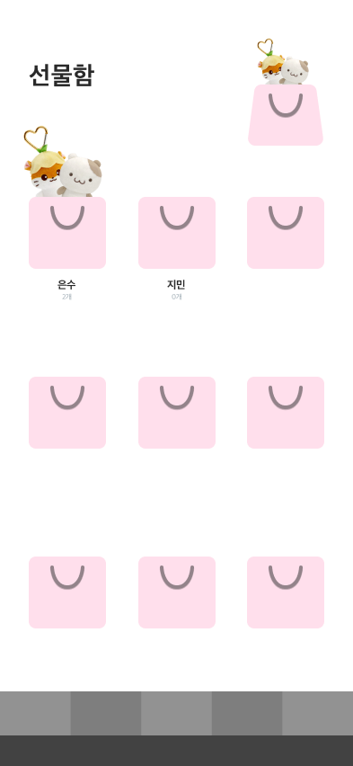
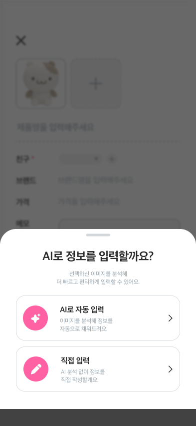
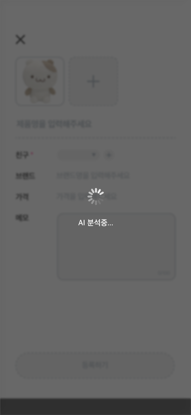

# 사용성 테스트 기반 프로토타입 수정

사용성 테스트에서 발견된 문제점과 사용자 피드백을 바탕으로 팀 내 논의를 진행하였다. 이후 문제별 해결 방향을 결정하고, 이를 Figma 프로토타입에 반영하였다.

### 1. 친구 추가 취소 버튼 추가

- **문제점:** 친구 추가 취소 기능이 토글로 표시되어 있어 사용자가 해당 기능을 쉽게 발견하지 못함.
- **해결 방법:** 친구 추가 상태를 명확하게 변경할 수 있도록 **‘친구 추가 취소’ 버튼을 별도로 추가**함.

### 2. 선물함 페이지 추가

- **문제점:** 사용자가 등록한 상품이 어디에 저장되는지 확인하기 어려움.
- **해결 방법:** 등록한 상품을 한곳에서 확인할 수 있도록 **‘선물함’ 페이지를 추가**함.

### 3. 마이 메뉴 위치 변경

- **문제점:** 하단 내비게이션에서 다른 메뉴는 아이콘으로 표시되지만, 마이 메뉴만 ‘MY’라는 텍스트로 표시되어 디자인의 통일성이 부족함.
- **해결 방법:** **마이 메뉴를 상단으로 이동**하고, 하단 내비게이션에서 기존 MY 항목을 제거함.

### 4. 이모지를 통일된 아이콘으로 변경

- **문제점:** 기존 이모지 사용으로 인해 바이브 코딩으로 제작한 듯한 인상을 주며, 전체적인 디자인의 통일성이 부족함.
- **해결 방법:** 기존 이모지를 제거하고 **링크, 사진, 캘린더, 선물함, 공유 아이콘을 추가**하여 일관된 디자인을 적용함.

### 5. 친구 선택 페이지 추가

- **문제점:** 선물 등록 과정에서 친구 선택은 유일한 필수 항목이지만, 기존 스크롤 방식은 친구 목록이 길어질 경우 원하는 친구를 찾기 어려움.
- **해결 방법:** 카카오톡 공유 시 채팅방을 선택하는 UI를 참고하여 **별도의 ‘친구 선택 페이지’를 추가**하고, 해당 페이지에서 친구를 선택하도록 수정함.

### 6. 사진 등록 개수 확대

- **문제점:** 사용성 테스트 이후 추가 질문에서 모든 참여자가 사진 등록 개수로 5장을 선택함.
- **해결 방법:** 사용자 의견을 반영하여 **사진을 최대 5장까지 등록할 수 있도록 수정**함.

### 7. 상세 페이지 공유 버튼 추가

- **문제점:** 공유 기능을 자주 사용할 것으로 예상되지만, 기존에는 더보기 메뉴를 통해 접근해야 해 접근성이 떨어짐.
- **해결 방법:** 상세 페이지에서 **기존 홈 버튼을 공유 버튼으로 변경**하여 공유 기능에 바로 접근할 수 있도록 수정함.

### 8. AI 분석 선택 기능으로 변경

- **문제점:** 기존 상품 등록 과정에서 AI 분석을 필수로 진행해야 해 사용자가 원하지 않아도 분석 단계를 거쳐야 함.
- **해결 방법:** **AI 분석을 필수 단계에서 선택 기능으로 변경**하여 사용자가 필요에 따라 분석 여부를 결정할 수 있도록 수정함.

